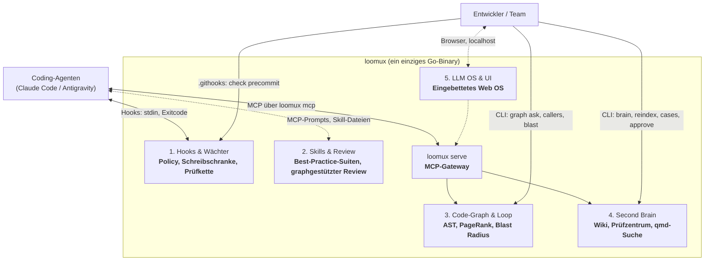

# loomux

🌐 **[English](README.md)** | **[Deutsch](README.de.md)** · 📖 **[Docs (EN)](docs/en/)** | **[Handbuch (DE)](docs/de/)**

**Ein Go-Binary, das KI-Coding-Agenten bewacht: Hooks und eine Schreibschranke, eine Prüfkette, ein Code-Graph und ein Projekt-Wiki.**

Claude Code und Antigravity arbeiten über Hooks mit loomux: Jedes Schreiben über die Dateiwerkzeuge des Hosts wird vor der Ausführung gegen die Regeln des Projekts und eine Schreibschranke geprüft, jeder Shell-Befehl gegen die Regeln des Projekts, und die Prüfkette läuft nach jeder Bearbeitung und am Ende jeder Runde. Cursor arbeitet nur als MCP-Client mit loomux, und Codex ist noch nicht angebunden. Über den MCP-Dienst fragt ein Agent den Code-Graphen und das Projekt-Wiki, statt das Repository erneut zu lesen.

- **Ein Binary.** loomux selbst braucht keine Python- oder Node-Laufzeit; die Werkzeuge, die es aufruft, etwa qmd für die Wiki-Suche und die Linter der Prüf-Lanes, können eine eigene brauchen.
- **Schneller Wächter.** Der Wächter entscheidet innerhalb eines Budgets von 35 ms.
- **Getestet je Funktion.** 100 % Testabdeckung je Funktion; eine Ausnahme braucht eine Begründung im Code.
- **Keine Telemetrie.** loomux selbst geht nur für Updates über `gh`, für das `git ls-remote origin` der Subagent-Hooks und auf ausdrückliche Befehle ins Netz. Die Prüfwerkzeuge, die seine Lanes starten (`uvx`, `npx`, `uv run --with`), können von sich aus Pakete herunterladen.
- **Windows zuerst.** Binaries für Linux und macOS gibt es auch, getestet wird aber unter Windows; Hook-Einrichtung und Selbstaktualisierung gibt es nur unter Windows.

> **Woher kommt der Name?**  
> **Loomux** verbindet den **Loom** (den Webstuhl, der die Fäden aus Agenten-Loops, Code-Graphen und Team-Wissen zu einem dichten, nahtlosen Gewebe verwebt) mit der Endung **-ux** (inspiriert von der Unix-Philosophie robuster, modularer Betriebssystem-Werkzeuge sowie einer kompromisslosen Developer & Agent Experience).

---

## Schnellstart (Windows)

Du brauchst die [GitHub CLI](https://cli.github.com/), angemeldet per `gh auth login`; sie übernimmt den Download und später die Selbstaktualisierung.

1. Lade das neueste stabile Release, prüfe es gegen `SHA256SUMS` und installiere es als `loomux.exe`. Führe das in PowerShell aus:

   ```powershell
   $bin = "$env:LOCALAPPDATA\loomux\bin"
   New-Item -ItemType Directory -Force $bin | Out-Null
   gh release download --repo xidus90/loomux --pattern 'loomux_*_windows_amd64.exe' --pattern SHA256SUMS --dir $bin --clobber
   $exe = Get-ChildItem $bin -Filter 'loomux_*_windows_amd64.exe' | Select-Object -First 1
   if (-not $exe) { throw 'download failed: see the gh error above' }
   $want = ((Select-String -Path "$bin\SHA256SUMS" -Pattern $exe.Name -SimpleMatch).Line -split '\s+')[0]
   if ((Get-FileHash $exe.FullName -Algorithm SHA256).Hash -eq $want) { Move-Item -Force $exe.FullName "$bin\loomux.exe"; Remove-Item "$bin\SHA256SUMS" } else { throw "checksum mismatch: $($exe.Name)" }
   ```

2. Richte in einer beliebigen Sitzung dein eigenes Projekt ein (`cd <projekt>`). `init` zeigt jede Änderung als Diff und schreibt nur, was du mit `y` bestätigst:

   ```powershell
   & "$env:LOCALAPPDATA\loomux\bin\loomux.exe" init
   ```

3. Prüfe die Einrichtung:

   ```powershell
   & "$env:LOCALAPPDATA\loomux\bin\loomux.exe" status
   ```

Die vollen Pfade sind nötig, weil nichts den Ordner auf deinen `PATH` setzt. Unter Linux oder macOS siehe [Linux und macOS](docs/de/install.md#linux-und-macos); alles Weitere zur Installation steht in [loomux installieren](docs/de/install.md), der nächste Schritt ist die [Ersteinrichtung](docs/de/getting-started.md).

---

## Wie es zusammenhängt



*Eine gestrichelte Linie ist spezifiziert und nicht gebaut; was als Nächstes kommt, steht in der [Roadmap](#roadmap).*

---

## Funktionen

| Funktion | Was sie leistet | Doku |
|---|---|---|
| **Wächter und Schreibschranke** | Hooks prüfen jedes Schreiben über die Dateiwerkzeuge des Hosts und jeden Shell-Befehl gegen die Pfade, Befehle und Schreibregeln des Projekts, bevor sie laufen, und verweigern sie mit Nennung der Regel. `.loomux/config.toml` ist für Agenten schreibgeschützt, außer ein Mensch schaltet für das Projekt mit `loomux config llm on` den Schalter `llm_config` ein; das alles gilt innerhalb der Grenzen, die in den [Hooks](docs/de/hooks.md#7-der-entscheidungsweg-von-pre-tool-use) aufgelistet sind. | [Hooks](docs/de/hooks.md) |
| **Prüfkette und Tor** | Standardmäßig laufen nach jeder Bearbeitung die Lanes für Lint und Typen über die geänderte Datei; am Rundenende und im Git-Hook laufen die Lanes für Lint, Typen, Test, Coverage, Graph und Regeln über den neuen Inhalt der Runde und über den Commit. In einem Projekt mit `.loomux/armed.toml` ist eine Lane, die die Datei nicht nennt, in Probe: Sie läuft und berichtet, lässt aber nichts scheitern, bis sie scharf gestellt ist. `loomux check linecov` hält jede ausführbare Zeile an einer Regel, in jeder Sprache, deren Coverage-Werkzeug LCOV, Cobertura, JaCoCo-XML oder ein Go-Profil schreibt: gelaufen, oder mit Begründung ausgenommen; Bereich und Marker stammen aus den eigenen Einstellungen des Werkzeugs. `loomux check godot-suite` führt die gdUnit4-Suite eines Godot-Projekts headless in Scherben aus, auf Wunsch mit Nano Coverage, und `loomux godot rescan` erneuert dessen Klassen-Cache; die `test`- und `coverage`-Lanes von `gdscript` nutzen sie, wo das Projekt die Addons mitbringt. `loomux check rules` hält ein Projekt an seiner eigenen Ebenenkarte (`[rules.layers]`): keine Kante von einer Ebene in eine, die sie nicht benutzen darf, ein Testmodul für jede Quelle einer Ebene, die eines verlangt, keine Quelle außerhalb jeder Ebene und keine Coverage-Instrumentierung in einem Commit; ein Projekt ohne `[rules]` bekommt keine Regel-Lane; GDScript-Projekte führen im Lint nun außerdem `gdformat --check` aus. | [Konfiguration](docs/de/configuration.md#verify-prüfketten--quality-gates), [Ebenenkarte](docs/de/configuration.md#rules-die-ebenenkarte), [CLI-Referenz](docs/de/cli-reference.md#loomux-check-rules---root-path---cached) |
| **Code-Graph** | Ein lokaler, deterministischer Graph aus Go-, Python- und GDScript-Code; GDScript von Godot 3 wie Godot 4, mit Szenen, ihren Signalverbindungen und `uid://`-Pfaden. `graph ask` rankt Symbole nach lexikalischer Relevanz und Personalized PageRank, `callers`, `skeleton`, `grep` und `map` navigieren darin, und `blast` zeigt, was ein Git-Diff erreicht. | [CLI-Referenz §6](docs/de/cli-reference.md#6-code-graph-engine-loomux-graph) |
| **Wiki und Second Brain** | Markdown-Wikis, als Bereiche eines Repositorys registriert, Seite für Seite gelesen und durchsucht über qmd (`brain search`), das du getrennt installierst. `reindex` baut die Kataloge, den Link-Graphen und das Identitätsregister neu, `reconcile` öffnet für jede Wiki-Seite, deren Quelle sich geändert hat, einen Prüffall, und ein Mensch entscheidet, was ein Fall ändert (`cases`, `approve`). | [CLI-Referenz §7](docs/de/cli-reference.md#7-second-brain--wiki-loomux-brain) |
| **MCP-Dienst** | `loomux serve` bietet die Werkzeuge `brain_*` und `graph_*` auf dem Loopback an, ein Token je Kanal (lokal oder Cloud). `loomux mcp` ist die stdio-Brücke, die ein Host startet; sie bietet nur die Werkzeuge der Module an, die das Projekt eingeschaltet lässt. | [CLI-Referenz §8](docs/de/cli-reference.md#8-mcp-dienst--stdio-brücke-loomux-serve--loomux-mcp) |
| **Flows** | Flows als Daten: ein Graph aus Knoten in TOML, der läuft, an einem Tor auf die Antwort eines Menschen wartet und sich aus einem Journal fortsetzen und wiedergeben lässt (`flow run\|resume\|replay\|show\|list`). Tor- und Ausgangsknoten laufen heute; Agentenknoten stehen in der [Roadmap](#roadmap). | [Flows](docs/de/flows.md) |
| **Worktree-Spiegel** (nur Windows) | `worktree link\|unlink\|remove` legen die Verzeichnisse, die ein Projekt nennt, als Junctions in seine verknüpften Git-Worktrees und nehmen sie wieder heraus. | [CLI-Referenz §5](docs/de/cli-reference.md#5-worktree-spiegelung-loomux-worktree) |
| **Releases und Selbstaktualisierung** (nur Windows) | `serve` holt täglich über `gh` das neueste Release des Kanals, dem das Binary folgt (stabil oder Beta), prüft es gegen `SHA256SUMS` und tauscht das Binary; `loomux upgrade` tut dasselbe von Hand und wechselt den Kanal. | [loomux installieren](docs/de/install.md#updates-und-kanäle) |

---

## Dokumentation

Leitfäden und technische Handbücher sind unter [`docs/de/`](docs/de/) gegliedert:

| Handbuch | Beschreibung |
|---|---|
| 📦 **[loomux installieren](docs/de/install.md)** | Voraussetzungen, Schnellstart unter Windows, einen Download prüfen, das maschinenweite Binary, Updates und Kanäle, Linux und macOS sowie der Bau aus dem Quellcode. |
| 🚀 **[Erste Schritte](docs/de/getting-started.md)** | Die Ersteinrichtung nach der Installation: `loomux init`, die Konfiguration und die Einrichtung prüfen und deinen Agenten-Harness anbinden (Hooks für Claude Code und Antigravity, MCP für Cursor). |
| 🧭 **[Unterstützte Sprachen und Versionen](docs/de/support.md)** | Welche Sprachen loomux prüft, was es für jede ausführt (lint, types, test, coverage, Code-Graph, Ebenenkarte) und gegen welche Versionen das geprüft ist. |
| ⚙️ **[Konfigurations-Referenz](docs/de/configuration.md)** | Vollständige Referenz für `.loomux/config.toml` (`[verify]`, `[policy]`, `[modules]`, `[commit]`, `[worktree]`, `[privacy]`, `[model]`, `[agent]`, `[flow]`). |
| 📖 **[CLI-Referenzhandbuch](docs/de/cli-reference.md)** | Detailliertes Handbuch aller Befehle, Flags, stdin-JSON-Nutzlasten und Exit-Codes. |
| 🪝 **[Hook-Lebenszyklus & Integration](docs/de/hooks.md)** | Technische Spezifikation des 4-Phasen-Hook-Zyklus, der Host-Formate und des entkoppelten SSE-Ereignisstroms. |
| 🏛️ **[Architektur & Konzepte](docs/de/architecture.md)** | Das theoretische Fundament: Andrej Karpathys LLM OS, Googles Knowledge Items (KI), AST-GraphRank und der Schreibschranken-Kernel. |
| 🔀 **[Flows](docs/de/flows.md)** | Flows als Daten: das Ordnerformat, Rollen und Modelle, der Katalog und das Überschreiben, einen Flow beitragen und warum ein Tor einem Menschen gehört. |
| 🏷️ **[Releases und Pull Requests](docs/de/releases.md)** | Wie ein gemergter Pull Request zum Release wird, Beta-Releases, einen Pull Request öffnen und die Release-Einrichtung der Maintainer. |
| ⏱️ **[Leistungs-Benchmarks](docs/de/benchmarks.md)** | Chronologische Leistungsmessungen mit Datum, Basis und Änderung, kalt und warm. |
| 📊 **[Benchmark-Matrix](docs/de/benchmarks/matrix.md)** | Open-Source-Matrix über Top-Sprachen hinweg mit Detailberichten pro Sprache und Repository. |

---

## Roadmap

Was loomux als Nächstes bekommt. *Priorität* ordnet die Zeilen (1 zuerst); die Roadmap legt sie fest, und sie zu ändern ist Entscheidung des Nutzers.

### Kommt

| Funktion | Was sie bringt | Hängt ab von | Priorität |
|---|---|---|---|
| **Flow-Laufzeit** | Flows als Daten: ein Graph aus Knoten in TOML, der läuft, an einem Tor auf die Antwort eines Menschen wartet und sich aus einem Journal fortsetzen und wiedergeben lässt. Gebaut: das Ordnerformat mit seiner Ladeprüfung, der Katalog, Rollen, die `[agent]` an Modelle bindet, Overlays, `[flow] default` und `overrides`, die Wächterregeln für Torantworten, Laufdateien und mitgelieferte Flows, `loomux flow run\|resume\|replay\|show\|list` und der Hinweis des Session-Starts auf wartende Läufe ([Flows](docs/de/flows.md)). Tor- und Ausgangsknoten laufen; Agentenknoten warten auf die Modelladapter für Claude und Gemini (über deren CLIs, deren APIs oder beides, was noch zu entscheiden ist), und `verify-until-green` als Daten-Flow für die Bausteine, die sie noch braucht; sie wird auch einen Diagnoselauf ohne Modell (`run --no-model`) nehmen | Flow-Kern ohne Modelle ✅ | 4 |
| **Flows über MCP** | `flow_list`, `flow_show`, `flow_run` (ein Lauf in einem Kindprozess, den `serve` ablöst, mit sofortiger Antwort der Laufnummer) und `flow_status` auf dem lokalen Kanal, mit einer Statusdatei je Lauf, damit ein abgebrochener Lauf erkannt und fortgesetzt wird; kein Werkzeug beantwortet ein Tor | Flow-Kern ohne Modelle ✅ | 4 |
| **Entwicklungszyklus als Default-Flow** | Von der Planung bis zum Pull Request: Klärung, Spec und Plan, jeweils von einem Fächer aus Prüflinsen geprüft, dann je Aufgabe Recherche, Test zuerst, Bau, Prüfkette, Codereview und Nacharbeit, zum Schluss Doku, Abschlussreview und Commit. Ein Mensch antwortet an festen Toren und immer dann, wenn ein Modell nicht weiterkommt, und pusht | Flow-Laufzeit | 4 |
| **Community-Flows** | Der Entwicklungszyklus ist nur die Vorgabe. Gebaut: der Katalog unter `flows/catalog/` mit seinem Beitragstest (`go test ./flows` gegen ein Golden-Journal), `[flow] default` zur Wahl des Flows, Overlays einzelner Anweisungen und Fragen und Rollen, die ein Projekt an eigene Modelle bindet. Echte Läufe beigetragener Flows mit Agentenknoten warten auf die Modelladapter | Flow-Kern ohne Modelle ✅ | 4 |
| **Web-OS-Shell** | Eine React/Vite-App, per `go:embed` eingebettet und von `loomux serve` auf `127.0.0.1` ausgeliefert: Eventbus, Layout, Command-Palette | MCP-Dienst ✅ | 5 |
| **Brain-Web-App** | Das Second Brain im Browser: Markdown-Editor, ADR-Katalog, Wissensgraph, die Kanten über Bereichsgrenzen (`edges-cross.json`) und im Browser ein Seitenleser, die Volltextsuche und das Prüfzentrum | Web-OS-Shell | 5 |
| **Graph-Visualizer** | Ein interaktiver Code-Graph mit Kanten-Chips, Typfiltern und Blast-Overlays; Code-Symbole verknüpft mit ADRs und Entwurfsdoku | Web-OS-Shell, Graph-Navigation ✅ | 5 |
| **Skill-Suiten und Review** | Eingebettete Best-Practice-Regeln je Sprache (Go, Python, TypeScript, Rust); ein graphgestütztes Review, das `graph_blast` liest und die ADR-Treue prüft; verteilt über `.loomux/config.toml`, Host-Ordner, MCP-Prompts und die Web-Oberfläche | Blast-Radius eines Diffs ✅ | 5 |
| **Flow-Editor und Kanban** | Flows als Graph im Web-OS zeichnen, wiedergeben und debuggen, im selben Format wie die Flow-Dateien; ein Kanban-Board, das Agentenschleifen, Prüf-Lanes und Subagenten live verfolgt | Web-OS-Shell, Flow-Laufzeit | 5 |
| **TypeScript/TSX im Code-Graphen** | Extraktion auf demselben Tree-sitter-Kern in reinem Go (`gotreesitter`), der schon Python liest | Python im Code-Graph ✅ | 6 |
| **Python-Quellwurzeln aus einer Projektdatei** | Der Python-Resolver errät, wo absolute Importe beginnen (Repository-Wurzel, der Ordner über jedem Top-Level-Paket, jeder Ordner mit `manage.py`); wo eine Projektdatei die Wurzeln festlegt, soll sie gelesen werden. Ob `pyproject.toml` das tut, ist offen: nur in werkzeugeigenen Formen, wenn überhaupt | — | — |
| **Typisierte Felder im GDScript-Resolver** | Aufrufe und Signale auf einem Feld mit Typannotation (`var _screen: ColonyScreen`, dann `_screen.refresh()` oder `_screen.build_requested.connect(…)`) ergeben heute keine Kante. Der Extraktor hielte den annotierten Typ jedes Felds fest, der Resolver bindet das Feld darüber; lokale Namen und Parameter, die ein Feld verdecken, brauchen Regeln | — | — |
| **C++ im Code-Graphen** | Derselbe Kern für C++, sobald eine Recall-Prüfung von `gotreesitter` gegen die C-Laufzeit trägt | GDScript im Code-Graph ✅ | 6 |
| **`verify.profiles` über `config set`** | `loomux config set verify.profiles… --propose` lehnt den Schlüssel als unbekannt ab; der Vorschlagsweg dieses Repositorys erreicht ihn nicht | — | — |
| **Eine Repo-Wurzel als Wiki** | `[layout] wiki` lehnt die Wurzel eines Repositorys ab; ein Wiki-Repository wie ein reines Wiki-Projekt hat so keine Wiki-Lane | — | — |
| **`dev bench cases` ohne Hook** | `dev bench cases` lehnt eine `settings.json` ohne Hook ab, statt nur die Zusatzfälle zu schreiben | — | — |
| **Registerrevisionen nur aus der Prüfung** | Der Indexlauf schreibt nur Neuanlagen und Umbenennungen in `_identities.tsv` und zählt die Revision nicht mehr bei jeder Hashänderung hoch; zwei Rechner mit derselben Geschichte schreiben so dieselben Zeilen in ein versioniertes Register; `reconcile` schiebt den Hash einer Registerzeile, die keine Seite zitiert, vor, ohne ihre Revision zu erhöhen | — | — |
| **Registerkennungen, die nie entfallen** | `_identities.tsv` behält jede `doc_id`: Aliase für einen Pfad, ein Grabstein für eine verschwundene Datei, `merge=union` für zwei Zweige; heute überschreibt ein doppelter Pfad still, und eine gelöschte Datei verliert ihre Zeile | — | — |
| **`reindex` aus einem verknüpften Worktree** | `reindex` findet den Bereich eines verknüpften Worktrees über das gemeinsame Git-Verzeichnis und schreibt nur das Register dieses Zweigs; heute indexiert es immer den registrierten Pfad | Registerkennungen, die nie entfallen | — |
| **Die Schreibschranke schützt das Register** | Die Schranke verweigert jedes Schreiben auf `_identities.tsv` in einem registrierten Bereich, über Write/Edit und über die Shell; heute darf ein Agent es ändern | — | — |
| **Was ein Projekt beim Sitzungsstart braucht** | `hook session-start` warnt, wenn `core.hooksPath` nicht auf die versionierten Hooks zeigt oder das Repository kein Arbeitsbaum ist, und ein Projekt kann eigene Schritte einhängen; heute behält ein Projekt wie `space` dafür ein eigenes Sitzungsstart-Skript neben loomux, für diese Warnungen, einen Auszug aus dem Log und ein eigenes Godot-`user://` je Worktree | — | — |

### Vielleicht

| Funktion | Was sie bringt | Warum nur vielleicht |
|---|---|---|
| **Claude-Mods-Adapter** | Setzt die Schreibschranke in einen `tool.check`-Function-Hook ([claude-code#91870](https://github.com/anthropics/claude-code/issues/91870)), der über `$.mcp.call` mit einem langlebigen loomux spricht: kein Spawn je Aufruf, ein `ask`-Urteil und eine gerenderte Begründung | Nur Claude Code; der Exec-Hook bleibt der portable Weg |
| **Artefakte im Zustandsverzeichnis** | Ein schreibbarer Bereich behält im Baum nur seinen Wurzelkatalog; `graph.json` und die Kataloge je Verzeichnis wandern ins Zustandsverzeichnis, und ein Schritt des Umzugs räumt die alten aus jedem Bereich | Noch verlangt nichts danach, und die Kataloge je Verzeichnis sind Navigation im Baum |
| **`reindex` committet das Register** | `reindex` committet eine Änderung am Register über `internal/brain/vcs`, wie es `approve` tut | Noch verlangt kein Fall danach; `reindex` schreibt, ohne zu committen |

Ein Pull Request, der Roadmap-Arbeit beginnt, abschließt, hinzufügt oder
streicht, ändert diesen Abschnitt und sein englisches Gegenstück in
[`README.md`](README.md#roadmap).

---

## Credits

Code-Graph, Ranking und Blast-Radius sind angeregt von [trailhq/Graft](https://github.com/trailhq/Graft); die portierten Teile und ihre MIT-Lizenz stehen in [NOTICE.md](internal/notices/NOTICE.md).

---

## Lizenz

PolyForm Noncommercial License 1.0 (`LICENSE.md`).
