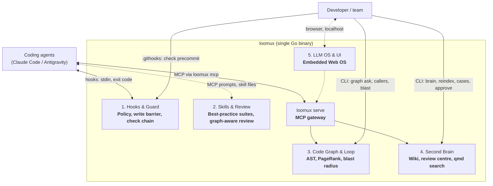

# loomux

🌐 **[English](README.md)** | **[Deutsch](README.de.md)** · 📖 **[Docs (EN)](docs/en/)** | **[Handbuch (DE)](docs/de/)**

**One Go binary that guards AI coding agents: hooks and a write barrier, a check chain, a code graph and a project wiki.**

Claude Code and Antigravity work with loomux through hooks: every write through the host's file tools is checked against the project's rules and a write barrier, and every shell command against the project's rules, before it runs, and the check chain runs after each edit and at the end of each turn. Cursor works with loomux only as an MCP client, and Codex is not wired yet. Through the MCP service an agent asks the code graph and the project wiki instead of reading the repository again.

- **One binary.** loomux itself needs no Python or Node runtime; the tools it calls, such as qmd for the wiki search and the linters of the check lanes, may need one of their own.
- **Fast guard.** The guard decides within a budget of 35 ms.
- **Tested per function.** 100 % test coverage per function; an exemption needs a reason in the code.
- **No telemetry.** loomux itself goes online only for updates through `gh`, for the `git ls-remote origin` of the subagent hooks, and on explicit commands. The check tools its lanes run (`uvx`, `npx`, `uv run --with`) may download packages on their own.
- **Windows first.** Binaries for Linux and macOS exist, but testing happens on Windows; hook setup and self-update are Windows only.

> **What’s in a name?**  
> **Loomux** brings together the **Loom** (the loom that weaves together agent loops, execution threads, code graphs, and team knowledge into a single coherent fabric) and **-ux** (inspired by the Unix philosophy of small, robust, composable OS tooling and a frictionless Developer/Agent Experience).

---

## Quickstart (Windows)

You need the [GitHub CLI](https://cli.github.com/), logged in with `gh auth login`; it does the download and, later, the self-update.

1. Download the newest stable release, check it against `SHA256SUMS` and install it as `loomux.exe`. Run this in PowerShell:

   ```powershell
   $bin = "$env:LOCALAPPDATA\loomux\bin"
   New-Item -ItemType Directory -Force $bin | Out-Null
   gh release download --repo xidus90/loomux --pattern 'loomux_*_windows_amd64.exe' --pattern SHA256SUMS --dir $bin --clobber
   $exe = Get-ChildItem $bin -Filter 'loomux_*_windows_amd64.exe' | Select-Object -First 1
   if (-not $exe) { throw 'download failed: see the gh error above' }
   $want = ((Select-String -Path "$bin\SHA256SUMS" -Pattern $exe.Name -SimpleMatch).Line -split '\s+')[0]
   if ((Get-FileHash $exe.FullName -Algorithm SHA256).Hash -eq $want) { Move-Item -Force $exe.FullName "$bin\loomux.exe"; Remove-Item "$bin\SHA256SUMS" } else { throw "checksum mismatch: $($exe.Name)" }
   ```

2. In any session, in your own project (`cd <project>`), set it up. `init` shows every change as a diff and writes only what you confirm with `y`:

   ```powershell
   & "$env:LOCALAPPDATA\loomux\bin\loomux.exe" init
   ```

3. Check the setup:

   ```powershell
   & "$env:LOCALAPPDATA\loomux\bin\loomux.exe" status
   ```

The full paths are needed because nothing puts the folder on your `PATH`. On Linux or macOS, see [Linux and macOS](docs/en/install.md#linux-and-macos); everything else about installing is in [Installing loomux](docs/en/install.md), the next step is [First-time setup](docs/en/getting-started.md).

---

## How it fits together



*A dashed line is specified and not built; what comes next is on the [roadmap](#roadmap).*

---

## Features

| Feature | What it does | Docs |
|---|---|---|
| **Guard and write barrier** | Hooks check every write through the host's file tools and every shell command against the project's paths, commands and write rules before it runs and refuse with the rule named. `.loomux/config.toml` is write-protected from agents; all of it holds within the limits listed in [Hooks](docs/en/hooks.md#7-the-decision-path-of-pre-tool-use). | [Hooks](docs/en/hooks.md) |
| **Check chain and gate** | By default the lint and type lanes run on the edited file after each edit; at the end of a turn and in the git hook the lanes for lint, types, test, coverage and graph run over the turn's new content and over the commit. In a project with `.loomux/armed.toml`, a lane the file does not name is in probation: it runs and reports, but fails nothing until it is armed. | [Configuration](docs/en/configuration.md#verify-check-chains--quality-gates) |
| **Code graph** | A local, deterministic graph of Go, Python and GDScript code. `graph ask` ranks symbols by lexical relevance and Personalized PageRank, `callers`, `skeleton`, `grep` and `map` navigate it, and `blast` shows what a git diff reaches. | [CLI reference §6](docs/en/cli-reference.md#6-code-graph-engine-loomux-graph) |
| **Wiki and second brain** | Markdown wikis registered as areas of a repository, read page by page and searched through qmd (`brain search`), which you install separately. `reindex` rebuilds the catalogs, the link graph and the identity register, `reconcile` opens a review case for each wiki page whose source changed, and a human decides what a case changes (`cases`, `approve`). | [CLI reference §7](docs/en/cli-reference.md#7-second-brain--wiki-loomux-brain) |
| **MCP service** | `loomux serve` offers the `brain_*` and `graph_*` tools on the loopback, one token per channel (local or cloud). `loomux mcp` is the stdio bridge a host starts; it offers only the tools of the modules the project leaves on. | [CLI reference §8](docs/en/cli-reference.md#8-mcp-service--stdio-bridge-loomux-serve--loomux-mcp) |
| **Flows** | Flows as data: a graph of nodes in TOML, run, paused at a gate for a human's answer, resumed and replayed from a journal (`flow run\|resume\|replay\|show\|list`). Gate and exit nodes run today; agent nodes are on the [roadmap](#roadmap). | [Flows](docs/en/flows.md) |
| **Worktree mirrors** (Windows only) | `worktree link\|unlink\|remove` put the directories a project names into its linked git worktrees as junctions and take them out again. | [CLI reference §5](docs/en/cli-reference.md#5-worktree-mirroring-loomux-worktree) |
| **Releases and self-update** (Windows only) | `serve` takes the newest release of the binary's channel (stable or beta) through `gh` daily, checks it against `SHA256SUMS` and swaps the binary; `loomux upgrade` does the same by hand and switches the channel. | [Installing loomux](docs/en/install.md#updates-and-channels) |

---

## Documentation

Guides and technical manuals are organized under [`docs/en/`](docs/en/):

| Guide | Description |
|---|---|
| 📦 **[Installing loomux](docs/en/install.md)** | Requirements, the Windows quickstart, verifying a download, the machine-wide binary, updates and channels, Linux and macOS, and building from source. |
| 🚀 **[Getting Started](docs/en/getting-started.md)** | First-time setup: `loomux init`, checking the configuration and the setup, and wiring your agent harness (hooks for Claude Code and Antigravity, MCP for Cursor). |
| ⚙️ **[Configuration Reference](docs/en/configuration.md)** | Complete reference for `.loomux/config.toml` (`[verify]`, `[policy]`, `[modules]`, `[commit]`, `[worktree]`, `[privacy]`, `[model]`, `[agent]`, `[flow]`). |
| 📖 **[CLI Reference Manual](docs/en/cli-reference.md)** | Comprehensive UNIX-style manual for all commands, flags, stdin JSON payloads, and exit codes. |
| 🪝 **[Hook Lifecycle & Integration](docs/en/hooks.md)** | Technical specification of the 4-phase hook lifecycle, host payload formats, and decoupled SSE event streaming. |
| 🏛️ **[Architecture & Concepts](docs/en/architecture.md)** | Deep dive into Andrej Karpathy's LLM OS, Google Knowledge Items (KI), AST GraphRank, and the Write Barrier Kernel. |
| 🔀 **[Flows](docs/en/flows.md)** | Flows as data: the folder format, roles and models, the catalog and overrides, contributing a flow, and why a gate is a human's. |
| 🏷️ **[Releases and Pull Requests](docs/en/releases.md)** | How a merged pull request becomes a release, beta releases, opening a pull request, and the maintainers' release setup. |
| ⏱️ **[Performance Benchmarks](docs/en/benchmarks.md)** | Chronological performance measurements with date, baseline and change, cold and warm. |
| 📊 **[Benchmark Matrix](docs/en/benchmarks/matrix.md)** | Open-source matrix across top languages with detailed reports per language and repository. |

---

## Roadmap

What loomux will gain next. *Priority* orders the rows (1 first); the roadmap sets it, and changing it is the user's decision.

### Coming

| Feature | What it brings | Depends on | Priority |
|---|---|---|---|
| **Flow runtime** | Flows as data: a graph of nodes in TOML, run, paused at a gate for a human's answer, resumed and replayed from a journal. Built: the folder format with its load check, the catalog, roles bound to models in `[agent]`, overlays, `[flow] default` and `overrides`, the guard rules for gate answers, run files and bundled flows, `loomux flow run\|resume\|replay\|show\|list` and the session-start notice of waiting runs ([Flows](docs/en/flows.md)). Gate and exit nodes run; agent nodes wait for the model adapters for Claude and Gemini (through their CLIs, their APIs or both, which is still to be decided), and `verify-until-green` as a data flow for the building blocks it still needs; it will also take a diagnosis run without a model (`run --no-model`) | Flow core without models ✅ | 4 |
| **Flows over MCP** | `flow_list`, `flow_show`, `flow_run` (a run in a child process `serve` detaches, answering at once with the run number) and `flow_status` on the local channel, with a status file per run so that a cut-off run is seen and carried on; no tool answers a gate | Flow core without models ✅ | 4 |
| **Development cycle as the default flow** | From planning to the pull request: clarification, spec and plan, each checked by a fan of reviewer lenses, then per task research, test first, build, check chain, code review and rework, then docs, final review and commit. A human answers at fixed gates and whenever a model is stuck, and pushes | Flow runtime | 4 |
| **Community flows** | The development cycle is only the default. Built: the catalog under `flows/catalog/` with its contribution test (`go test ./flows` against a golden journal), `[flow] default` to pick the flow, overlays of single instructions and questions, and roles a project binds to its own models. Real runs of contributed flows with agent nodes wait for the model adapters | Flow core without models ✅ | 4 |
| **Web OS shell** | A React/Vite app embedded with `go:embed` and served by `loomux serve` on `127.0.0.1`: event bus, layout, command palette | MCP service ✅ | 5 |
| **Brain web app** | The second brain in the browser: markdown editor, ADR catalog, knowledge graph, the cross-area edges (`edges-cross.json`) and in the browser a page reader, full-text search and the review centre | Web OS shell | 5 |
| **Graph visualizer** | An interactive code graph with edge chips, type filters and blast overlays; code symbols linked to ADRs and design docs | Web OS shell, Graph navigation ✅ | 5 |
| **Skill suites and review** | Embedded best-practice rules per language (Go, Python, TypeScript, Rust); graph-aware review that reads `graph_blast` and checks ADR conformance; distributed through `.loomux/config.toml`, host folders, MCP prompts and the web UI | Blast radius of a diff ✅ | 5 |
| **Flow editor and Kanban** | Flows drawn, replayed and debugged as a graph in the Web OS, in the same format as the flow files; a Kanban board that tracks agent loops, check lanes and subagents live | Web OS shell, Flow runtime | 5 |
| **TypeScript/TSX in the code graph** | Extraction on the same pure-Go Tree-sitter core (`gotreesitter`) that already reads Python | Python in the code graph ✅ | 6 |
| **Python source roots from a project file** | The Python resolver guesses where absolute imports start (the repository root, the directory above each top-level package, every `manage.py` directory); where a project file states the roots, it should be read instead. Whether `pyproject.toml` does is open: it states them only in tool-specific forms, if at all | — | — |
| **Typed fields in the GDScript resolver** | Calls and signals on a field with a type annotation (`var _screen: ColonyScreen`, then `_screen.refresh()` or `_screen.build_requested.connect(…)`) get no edge today. The extractor would record each field's annotated type, the resolver binds the field through it; locals and parameters that shadow a field need rules | — | — |
| **Scene autoloads in the GDScript resolver** | An autoload that is a scene (`Bus="*res://bus.tscn"`) binds to the scene's file node, so calls and signals through its name reach no script. The extractor would record each scene's root script, the resolver binds the name through it | — | — |
| **C++ in the code graph** | The same core for C++, once a recall check of `gotreesitter` against the C runtime holds | GDScript in the code graph ✅ | 6 |
| **`verify.profiles` through `config set`** | `loomux config set verify.profiles… --propose` refuses the key as unknown, so the proposal path of this repository does not reach it | — | — |
| **A repository root as the wiki** | `[layout] wiki` refuses the root of a repository, so a wiki repository such as a pure wiki project has no wiki lane | — | — |
| **`dev bench cases` without a hook** | `dev bench cases` refuses a `settings.json` without hooks instead of writing only the extra cases | — | — |
| **Register revisions only from review** | The index run writes only births and renames into `_identities.tsv` and no longer raises the revision on every hash change, so two machines with the same history write the same rows into a versioned register; reconcile moves the hash of a register row that no page cites forward without raising its revision | — | — |
| **Register ids that are never removed** | `_identities.tsv` keeps every `doc_id`: aliases for a path, a tombstone for a file that is gone, `merge=union` for two branches; today a duplicate path is overwritten silently and a deleted file loses its row | — | — |
| **`reindex` from a linked worktree** | `reindex` resolves the area of a linked worktree through the common git directory and writes only that branch's register; today it always indexes the registered path | Register ids that are never removed | — |
| **The write barrier guards the register** | The barrier refuses every write to `_identities.tsv` in a registered area, through Write/Edit and through the shell; today an agent may edit it | — | — |
| **What a project needs at session start** | `hook session-start` warns when `core.hooksPath` does not point at the versioned hooks or the repository is not a work tree, and a project can hang its own steps into it; today a project such as `space` keeps its own session-start script beside loomux for those warnings, a recent-log excerpt and a per-worktree Godot `user://` | — | — |
| **LCOV coverage gate** | `loomux check lcov`: reads and merges LCOV reports, holds each line to a threshold, takes exemption markers with a reason and refutes one on a line that ran, and is red on a report that is missing, empty or older than the run; for any tool that writes LCOV (Nano Coverage, vitest, gcovr) | — | — |
| **Godot test suite** | `loomux check godot-suite`: gdUnit4 headless in shards, Nano Coverage instrumented and restored, a stale class cache named with the command that refreshes it, and `test`/`coverage` presets for `gdscript` that use `{godot}` and `lock` | LCOV coverage gate | — |
| **Project rules as checks** | Built-in checks for a test module per source, leftover instrumentation, sources outside every checked directory and a core that must not reach the UI, configured per project | — | — |

### Maybe

| Feature | What it brings | Why only maybe |
|---|---|---|
| **Claude Mods adapter** | Seats the write barrier in a `tool.check` function hook ([claude-code#91870](https://github.com/anthropics/claude-code/issues/91870)) talking to a long-lived loomux over `$.mcp.call`: no spawn per call, an `ask` verdict and a rendered reason | Claude Code only; the exec hook stays the portable path |
| **Artefacts in the state directory** | A writable area keeps only its root catalog in its tree; `graph.json` and the catalogs per directory move to the state directory, and one step of the move clears the old ones from every area | Nothing asks for it yet, and the catalogs per directory are navigation inside the tree |
| **`reindex` commits the register** | `reindex` commits a change to the register through `internal/brain/vcs`, as `approve` does | No case asks for it yet; `reindex` writes without committing |

A pull request that starts, finishes, adds or drops roadmap work updates this
section and its German twin in [`README.de.md`](README.de.md#roadmap).

---

## Credits

The code graph, its ranking and the blast radius are inspired by [trailhq/Graft](https://github.com/trailhq/Graft); the ported parts and their MIT license are listed in [NOTICE.md](internal/notices/NOTICE.md).

---

## Licence

PolyForm Noncommercial License 1.0 (`LICENSE.md`).
